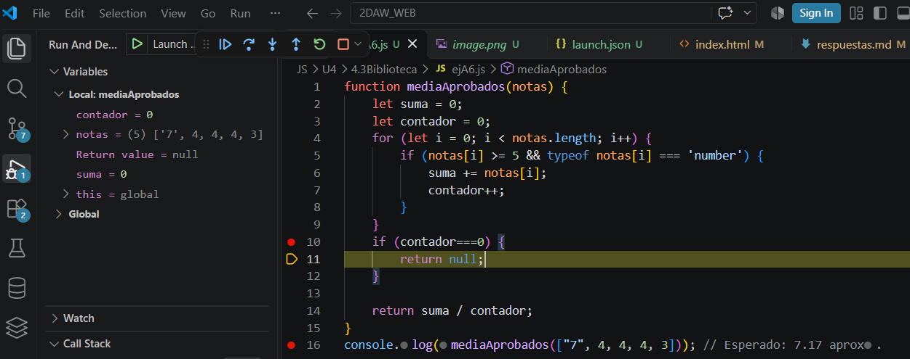

A1. Conversiones de tipos

| Expresión                | Mi predicción | Resultado real      | Tipo (typeof) | Explicación                           |
| ------------------------ | ------------- | ------------------- | ------------- | ------------------------------------- | 
| "5" + 3                  | "53"          | "53"                | string        | Une el texto y el número              |
| "5" \* 3                 | "555"         | 15                  | number        | Convierte el "5" en número            |
| "5" - "2"                | 3             | 3                   | number        | Los convierte en números              |
| Number("")               |               | 0                   | number        | Una cadena vacía se convierte en 0    |
| Number("12px")           | 12            | NaN                 | number        | No puede convertir todo a números     |
| parseInt("12px")         | 12            | 12                  | number        | Convierte solo el principio           |
| parseFloat("3.75€")      | 3.75          | 3.75                | number        | Convierte solo el principio           |
| "10" == 10               | true          | true                | boolean       | Compara convirtiendo a numero         |
| "10" === 10              | false         | false               | boolean       | Compara también el tipo de dato       |
| null + 1                 | error         | 1                   | number        | null se convierte en 0                |
| undefined + 1            | NaN           | NaN                 | number        | undefined produce NaN                 |
| typeof NaN               | number        | number              | number        | El tipo de NaN es number              |
| Boolean("0")             | true          | true                | boolean       | Una cadena con contenido es verdadera |
| 0|| "valor por defecto"  | 0             | valor por defecto   | string        | 0 es falso                            |
| 0 ?? "valor por defecto" | 0             | 0                   | number        | 0 no es ni null ni undefined          |

Para terminar, responde: ¿por qué NaN === NaN devuelve false? ¿Cómo compruebas correctamente si
un valor es NaN?
Porque aunque el tipo sea number, sigue representando un valor no valido que no es igual ni a si mismo.
Se puede comprobar con esta funcion: Number.isNaN(valor) o isNaN(valor) (pero en este caso trata de convertirlo,
si no lo puede convertir a numero entonces es True)

A2. Ámbito de las variables

1. ¿Qué muestra cada console.log? Ejecútalo después y compara.
   Prediccion
   calcularTotal(20, 3); :Dentro: 55
   console.log("Fuera:", total); : Fuera: 0
   no existe descuento

   Ejecutandolo
   Dentro: 55
   Fuera: 0
   Uncaught ReferenceError: descuento is not defined

2. ¿Por qué total vale distinto dentro y fuera de la función?
   Porque modifica la variable dentro del bucle

3. ¿Qué error produce la última línea y por qué?
   Uncaught ReferenceError. No puede acceder a la variable fuera del bucle

4. ¿Qué cambia si dentro de la función sustituyes let total = … por total = …?
   La variable global tambien se modifica

5. ¿Qué ocurre si añades gastosEnvio = 7; al final del programa?
   Nada, si se cambia despues de la función no afecta.

A3. Decisiones y bucles: boletín de notas

1. Recorre el array con un bucle for clásico y muestra la posición y la calificación de cada nota:
   Alumno 1 : 7.5 -> Notable
   Alumno 2 : 4.9 -> Insuficiente
   Alumno 3 : 10 -> Sobresaliente
   Alumno 4 : 5 -> Suficiente
   Alumno 5 : 6.25 -> Bien
   Alumno 6 : 3 -> Insuficiente
   Alumno 7 : 8.8 -> Notable
   Alumno 8 : 11 -> Nota no válida
   Alumno 9 : 9 -> Sobresaliente

2. Con un bucle for...of, calcula el número de aprobados, la media de las notas válidas y la nota
   más alta. No uses Math.max ni métodos de arrays en este ejercicio.
   Número de aprobados : 7
   Media(notas válidas): 6.80625
   Nota más alta: 10

A4. Set y Map: lista de inscripciones

1. Usa un Set para obtener los correos sin repetir. ¿Cuántos salen? ¿Por qué no es el resultado que
   esperabas?
   Distigue entre mayusculas y minusculas, por lo que salen 6. Deberian haber salido 4 si no tomata en cuenta eso.
   Set(6) {
   'ana@ies.es',
   'luis@ies.es',
   'ANA@ies.es',
   'marta@ies.es',
   'pablo@ies.es',
   'Marta@ies.es'
   }

2. Repite el apartado normalizando antes cada correo a minúsculas (correo.toLowerCase()).
   ¿Cuántos salen ahora?
   Ahora solo salen 4.
   Set(4) { 'ana@ies.es', 'luis@ies.es', 'marta@ies.es', 'pablo@ies.es' }

3. Usa un Map para contar cuántas veces aparece cada correo normalizado. Recórrelo y muestra
   luis@ies.es → 2.

   ana@ies.es-> 2
   luis@ies.es-> 2
   marta@ies.es-> 2
   pablo@ies.es-> 1

4. Convierte el Set del apartado 2 en un array ordenado alfabéticamente.
   Array(4)
      0: "ana@ies.es"
      1: "luis@ies.es"
      2: "marta@ies.es"
      3: "pablo@ies.es"

A5. Funciones y callbacks

1. Escribe transformar(array, fn), que devuelve un array nuevo aplicando fn a cada elemento. Usa un bucle, no map.
   (4) [21, 34, 13, 55]

2. Escribe quedarse(array, condicion), que devuelve un array nuevo con los elementos que cumplen la condición. Usa un bucle, no filter.
   (3) [20, 12, 54]

3. Pruébalas con funciones flecha: duplica los números de [3, 8, 1, 6] y quédate con los pares.
   (4) [6, 16, 2, 12]

4. Reescribe el apartado 3 con map y filter. Explica en dos líneas qué tienen en común tus funciones y los métodos de los arrays.
   (4) [4, 9, 2, 7]
   (2) [8, 6]

5. Con const precios = [12, 45, 8, 99, 30];, encadena métodos para obtener el total con IVA (21 %) de los productos de más de 10 €, redondeado a dos decimales.
   225.06

A6. Depuración 
1. Pon un punto de interrupción dentro del bucle y avanza paso a paso. Vigila i, notas[i], suma y typeof suma. Suma da 079.5 y es number.
2. Localiza al menos cuatro errores. Anótalos en esta tabla: 

|Línea |Error    |Cómo lo detectaste    |Corrección     |
|------|---------|----------------------|---------------|
|5    |no incluye las notas = a 5| la tercera nota no entra en el if |poner notas[i]>=5 |
|5    |pasa "7" como  string| concatena en vez de sumar    | añadir typeof notas[i] === 'number' |
|10   |no utiliza contador | divide entre 5      |  return suma / contador |
|4    |se pasa de posiciones| i llega hasta 5   |i < notas.length |
 
3. Corrige la función. Haz que devuelva null si no hay ninguna nota aprobada. 
   null
4. Adjunta una captura del depurador detenido en el punto de interrupción, con las variables visibles.

A6. Depuración 
1. Consulta en MDN la página del elemento <script> y explica con tus palabras qué hacen los atributos defer y async. Indica en qué se diferencian.
   Defer  establece que el script debe ejecutarse después de que el documento haya sido analizado por lo que mantiene el orden.
   En cambio, con async el sript se desgargara en paralelo al analisis y se ejecuta cuando termine de descargarse sin tener en cuenta el orden.

2. Haz la prueba: quita defer de los dos <script> de index.html, recarga la página y copia el 
error que aparece en la consola. ¿Por qué se produce? 
   app.js:11 Uncaught TypeError: Cannot set properties of null (setting 'innerHTML')
    at mostrar (app.js:11:46)
    at app.js:2:1
   Porque el navegador está ejecutando app.js antes de haber terminado de leer el HTML. Cuando intenta ejecutar mostrar("#catalogo", "
Lista de libros
"); pero aun no existe catalogo.

3. Vuelve a poner defer y cambia el orden de los scripts, de modo que app.js se cargue antes que 
datos.js. ¿Qué error aparece ahora y por qué?
   Si intento utilizar una variable que esta en datos  (mostrar("#catalogo", tablaLibros(LIBROS))) da este error porque aun no esta definida:
   Uncaught ReferenceError: tablaLibros is not defined
    at app.js:60:1

4. ¿Por qué defer es más adecuado que async en este proyecto?
   Porque el orden es importante, app.js depende de datos.js.